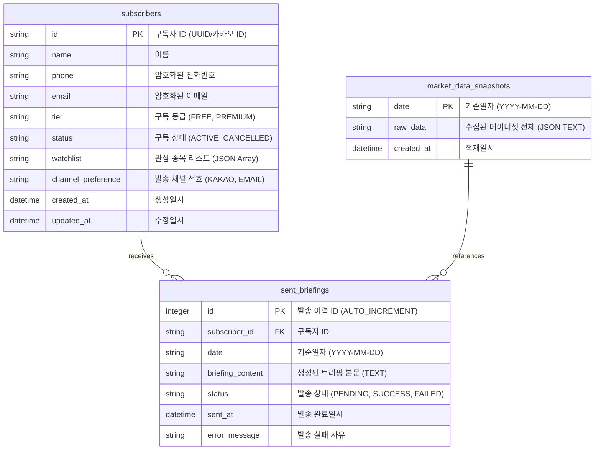

# 데이터베이스 설계서 (DB Specification)

**작성일**: 2026.07.06  
**작성자**: Antigravity (AI Coding Assistant)  
**버전**: v1.0  
**타겟 DB**: SQLite (향후 PostgreSQL 마이그레이션이 용이하도록 설계)

---

## 1. 설계 원칙 및 방향성

1. **심플하고 직관적인 구조 (Keep It Simple)**:
   - 관계형 정규화를 과도하게 적용하지 않고, 모닝 브리핑 배치 처리 및 LLM 프롬프트 생성에 최적화된 형태로 단순화합니다.
2. **반정규화 & JSON 필드 활용**:
   - 일일 수집되는 방대한 금융 시세/수급/공시 데이터는 개별 테이블로 모두 쪼개지 않고, 날짜별 하나의 거대한 JSON 스냅샷(`market_data_snapshots`)에 담아 보관합니다. 이 방식은 LLM 및 검증기가 원본 데이터셋을 한 번에 읽어 대조하기에 매우 용이합니다.
   - 구독자의 관심종목 역시 N:M 관계 테이블 대신, 구독자 테이블 내에 JSON 배열(`["005930", "000660"]`) 형태의 문자열로 가볍게 보관합니다. (최대 5개 제한 조건에 부합)
3. **개인정보 보호**:
   - 구독자의 연락처(이메일, 전화번호)는 향후 개인정보 보호법 준수를 위해 대칭키 암호화(예: Fernet)를 고려한 크기/타입으로 설계합니다.

---

## 2. ER 다이어그램 (Entity Relationship Diagram)



---

## 3. 상세 테이블 명세 (Schema Specification)

### 3.1 구독자 테이블 (`subscribers`)
구독자의 상태, 요금제 티어, 관심종목 등을 보관하는 테이블입니다.

| 컬럼명 | 데이터 타입 | Nullable | 기본값 | 설명 |
| :--- | :--- | :---: | :--- | :--- |
| `id` | VARCHAR(50) | No | - | **Primary Key** (카카오 고유 ID 혹은 UUID) |
| `name` | VARCHAR(50) | No | - | 구독자 이름/닉네임 |
| `phone` | VARCHAR(255) | Yes | NULL | 암호화된 휴대폰 번호 (알림톡 발송용) |
| `email` | VARCHAR(255) | Yes | NULL | 암호화된 이메일 주소 (이메일 브리핑용) |
| `tier` | VARCHAR(20) | No | 'FREE' | 구독 티어 (`FREE`, `PREMIUM`) |
| `status` | VARCHAR(20) | No | 'ACTIVE' | 구독 상태 (`ACTIVE`, `CANCELLED`, `EXPIRED`) |
| `watchlist` | TEXT | No | '[]' | 관심 종목 코드 리스트 (JSON 배열 예: `["005930", "000660"]`) |
| `channel_preference` | VARCHAR(20) | No | 'KAKAO'| 발송 채널 선호도 (`KAKAO`, `EMAIL`) |
| `created_at` | DATETIME | No | CURRENT_TIMESTAMP | 계정 생성 일시 |
| `updated_at` | DATETIME | No | CURRENT_TIMESTAMP | 정보 수정 일시 |

---

### 3.2 일일 시장 데이터 스냅샷 테이블 (`market_data_snapshots`)
매일 아침 06:40 ~ 07:00에 수집된 국내외 모든 데이터(키움 지수/시세/수급, DART 공시, Yahoo 해외지수)를 통합 JSON 형식으로 보관합니다.

| 컬럼명 | 데이터 타입 | Nullable | 기본값 | 설명 |
| :--- | :--- | :---: | :--- | :--- |
| `date` | VARCHAR(10) | No | - | **Primary Key** (기준 날짜 `YYYY-MM-DD`) |
| `raw_data` | TEXT | No | - | 수집된 원본 통합 JSON 데이터셋 |
| `created_at` | DATETIME | No | CURRENT_TIMESTAMP | 데이터 적재 완료 시각 |

> **`raw_data` JSON 스키마 예시**:
> ```json
> {
>   "domestic_indices": {
>     "KOSPI": {"price": 2580.12, "change_pct": 0.45},
>     "KOSDAQ": {"price": 850.40, "change_pct": -0.12}
>   },
>   "overseas_indices": {
>     "DOW": {"price": 39120.50, "change_pct": 0.15},
>     "NASDAQ": {"price": 16270.80, "change_pct": 0.82}
>   },
>   "market_flow": {
>     "KOSPI": {"foreign": 1200, "institution": -800, "private": -400}
>   },
>   "watchlist_prices": {
>     "005930": {"stk_nm": "삼성전자", "price": 75000, "change_pct": 1.2}
>   },
>   "disclosures": [
>     {"stock_code": "000660", "corp_name": "SK하이닉스", "report_nm": "기재정정...", "rcept_no": "20260706000444"}
>   ]
> }
> ```

---

### 3.3 브리핑 발송 이력 테이블 (`sent_briefings`)
구독자에게 발송된 일일 브리핑 내용과 발송 상태(성공, 실패 및 실패 사유)를 추적합니다.

| 컬럼명 | 데이터 타입 | Nullable | 기본값 | 설명 |
| :--- | :--- | :---: | :--- | :--- |
| `id` | INTEGER | No | - | **Primary Key** (Auto Increment) |
| `subscriber_id` | VARCHAR(50) | No | - | **Foreign Key** (`subscribers.id` 참조) |
| `date` | VARCHAR(10) | No | - | 발송 기준일자 (`YYYY-MM-DD`) |
| `briefing_content` | TEXT | No | - | 생성 및 검증 완료된 최종 자연어 브리핑 본문 |
| `status` | VARCHAR(20) | No | 'PENDING' | 발송 성공 여부 (`PENDING`, `SUCCESS`, `FAILED`) |
| `sent_at` | DATETIME | Yes | NULL | 실제 전송 완료된 일시 |
| `error_message` | TEXT | Yes | NULL | 발송 실패 시 오류 원인 로그 |

---

## 4. 파이썬 ORM (SQLAlchemy) 가이드라인

데이터베이스와의 연동을 유연하게 처리하기 위해 Python의 대표적인 ORM인 `SQLAlchemy` 선언적 모델(Declarative Model)을 적용하여 연동 구조를 설계합니다.

```python
# database/models.py 예시 설계안
from datetime import datetime
from sqlalchemy import Column, String, Text, DateTime, Integer, ForeignKey
from sqlalchemy.orm import declarative_base

Base = declarative_base()

class Subscriber(Base):
    __tablename__ = "subscribers"
    
    id = Column(String(50), primary_key=True)
    name = Column(String(50), nullable=False)
    phone = Column(String(255), nullable=True)
    email = Column(String(255), nullable=True)
    tier = Column(String(20), default="FREE", nullable=False)
    status = Column(String(20), default="ACTIVE", nullable=False)
    watchlist = Column(Text, default="[]", nullable=False)  # JSON String
    channel_preference = Column(String(20), default="KAKAO", nullable=False)
    created_at = Column(DateTime, default=datetime.utcnow, nullable=False)
    updated_at = Column(DateTime, default=datetime.utcnow, onupdate=datetime.utcnow, nullable=False)

class MarketDataSnapshot(Base):
    __tablename__ = "market_data_snapshots"
    
    date = Column(String(10), primary_key=True)  # YYYY-MM-DD
    raw_data = Column(Text, nullable=False)       # JSON String
    created_at = Column(DateTime, default=datetime.utcnow, nullable=False)

class SentBriefing(Base):
    __tablename__ = "sent_briefings"
    
    id = Column(Integer, primary_key=True, autoincrement=True)
    subscriber_id = Column(String(50), ForeignKey("subscribers.id"), nullable=False)
    date = Column(String(10), nullable=False)
    briefing_content = Column(Text, nullable=False)
    status = Column(String(20), default="PENDING", nullable=False)
    sent_at = Column(DateTime, nullable=True)
    error_message = Column(Text, nullable=True)
```

---

## 5. 다음 액션 아이템

- [ ] `docs/DB_설계서.md` 최종 리뷰 및 컨펌
- [ ] `src/database/connection.py`에 SQLAlchemy 기반 DB 엔진 및 세션 팩토리 생성 코드 작성
- [ ] `src/database/models.py` 파일 생성 및 테이블 매핑 정의
