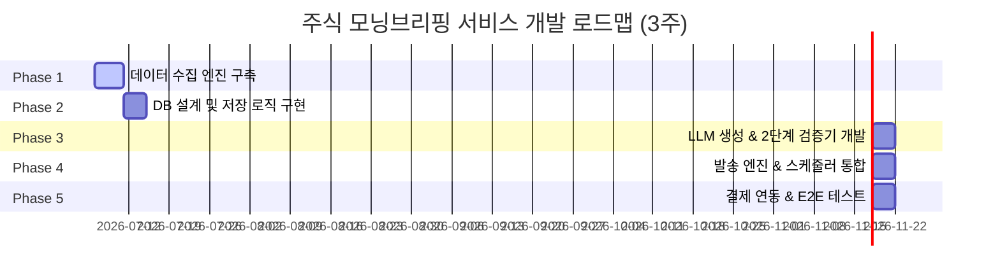

# 개발 계획서: 실데이터 기반 주식 모닝브리핑 구독 서비스

**작성일**: 2026.07.06  
**작성자**: Antigravity (AI Coding Assistant)  
**버전**: v1.0  

---

## 1. 프로젝트 개요 (Project Overview)

본 프로젝트는 LLM의 정보 환각(Hallucination) 현상을 완전히 배제하고, 공식 금융/공시 데이터 API와 직접 개발한 **키움 REST API SDK(`kiwoom-rest-trade`)**의 실데이터만을 활용하여 개인화된 주식 모닝브리핑을 생성 및 유통하는 자동화 시스템을 구축하는 것을 목적으로 합니다.

### 핵심 가치
- **100% 신뢰할 수 있는 데이터**: LLM은 데이터 포맷 변환 및 요약/해설 역할만 담당하며, 임의로 수치를 창작하지 못하도록 2단계 검증(Validation) 레이어를 구현합니다.
- **개인화 브리핑**: 구독자가 등록한 최대 5개의 관심종목 시세 및 공시 정보를 필터링하여 유료 구독자 전용 커스텀 섹션을 제공합니다.
- **다채널 최적화 유통**: 타겟 사용자가 가장 친숙한 카카오톡(알림톡/오픈채팅)과 이메일, 네이버 블로그를 연동하여 정보의 전달력을 극대화합니다.

---

## 2. 기술 스택 및 아키텍처 (Tech Stack & Architecture)

### 2.1 기술 스택
- **언어**: Python 3.12+ (uv 패키지 매니저 기반 가상환경)
- **핵심 의존성**:
  - `kiwoom-rest-trade` (로컬 개발 모드 연동): 키움증권 REST API 통신 담당
  - `httpx[http2]`: 비동기 HTTP 요청 처리 (Yahoo Finance, DART API 등)
  - `pydantic v2`: 데이터 스키마 정의 및 타입 안전성 보장
  - `python-dotenv`: 환경변수 관리
- **데이터베이스**: SQLite (MVP 단계에서 로컬 파일 기반으로 구축 후 향후 PostgreSQL 전환)
- **LLM 엔진**: Anthropic Claude 3.5 Sonnet API
- **스케줄러**: `APScheduler` 또는 Cron 시스템

### 2.2 파이썬 프로젝트 구조
```text
hermion-messenger/
├── docs/                 # 기획 및 설계 문서
├── src/
│   ├── collector/        # 데이터 수집 모듈 (키움, DART, Yahoo Finance)
│   ├── database/         # DB 스키마, CRUD 모듈
│   ├── generator/        # LLM 프롬프트 설계 및 브리핑 생성
│   ├── validator/        # 생성 텍스트의 수치 대조 및 검증 레이어
│   ├── dispatcher/       # 카카오 알림톡, 이메일, 블로그 발송 모듈
│   └── main.py           # 전체 배치 프로세스 실행 진입점
├── pyproject.toml        # 프로젝트 의존성 설정
└── .env.example          # API 키 및 DB 연결 문자열 템플릿
```

---

## 3. 상세 개발 일정 (Milestones & Schedule)

프로젝트 개발은 총 5개의 단계(Phase)로 나누어 진행되며, 3주 내에 MVP 버전을 완료하는 것을 목표로 합니다.



### Phase 1: 데이터 수집 엔진 구축 (1주차)
- [ ] `kiwoom-rest-trade` 비동기 클라이언트(`AsyncKiwoomClient`) 연동
- [ ] 국내 지수(코스피/코스닥) 및 투자자별 수급 데이터 수집 모듈 개발
- [ ] DART Open API 기반 당일 공시 데이터 수집기 개발
- [ ] Yahoo Finance API 기반 해외 지수(미국 3대 지수, 필라델피아 반도체) 수집기 개발

### Phase 2: DB 설계 및 저장 로직 구현 (1.5주차)
- [ ] SQLite 기반 데이터베이스 스키마 설계 (`Subscriber`, `MarketDataSnapshot` 등)
- [ ] 구독자 정보 등록, 변경, 조회 API/CRUD 함수 구현
- [ ] 일일 수집 데이터의 JSON 구조화 및 DB 적재 프로세스 자동화

### Phase 3: LLM 생성 및 2단계 검증 레이어 개발 (2주차)
- [ ] Claude API 연동 모듈 구현 및 데이터 전달 JSON 스키마 매핑
- [ ] 숫자 왜곡 방지를 위한 프롬프트 가드레일 설계
- [ ] 정규식 및 JSON 대조 기반의 **Double-Check Validator** (숫자 일치성 검증) 알고리즘 구현
- [ ] 불일치 시 1회 재생성 재시도 로직 구현

### Phase 4: 발송 엔진 및 스케줄러 통합 (2.5주차)
- [ ] AWS SES 또는 SMTP 기반 이메일 템플릿 작성 및 발송 기능 구현
- [ ] 비즈엠(Bizm) API 연동을 통한 카카오 알림톡 발송 모듈 구현
- [ ] 카카오 오픈채팅 봇 및 네이버 블로그 자동 포스팅 API 연동
- [ ] `APScheduler` 기반 매일 아침 06:40 데이터 수집부터 07:30 발송까지의 배치 작업 체인 구축

### Phase 5: 결제 연동 및 E2E 테스트 (3주차)
- [ ] 포트원(Portone/아임포트) API 연동을 통한 정기결제 처리 프로세스 구현
- [ ] 결제 취소/구독 해지 프로세스 연동
- [ ] 실데이터 기반의 전체 아침 배치 프로세스 E2E 모니터링 및 테스트 진행

---

## 4. 키움 API 연동 설계 고려사항

직접 개발한 `kiwoom-rest-trade` 라이브러리를 안전하게 도입하기 위해 아래 디자인 패턴을 적용합니다.

### 4.1 비동기 I/O 기반 수집 (Async-First)
수집 프로세스가 매일 아침 07:00 전후에 빠르게 종료되어야 하므로(유료 발송 데드라인 07:30), 여러 API 요청을 동시적(Concurrent)으로 처리하기 위해 `AsyncKiwoomClient`를 활용합니다.
```python
# 예시 구조
import asyncio
from kiwoom import AsyncKiwoomClient

async def collect_kiwoom_data():
    client = AsyncKiwoomClient(appkey=APP_KEY, secretkey=SECRET_KEY, is_mock=False)
    # 지수, 수급, 관심종목 조회를 asyncio.gather로 동시 처리하여 시간 단축
    results = await asyncio.gather(
        client.domestic.get_market_index(),
        client.domestic.get_investor_trend(),
        client.domestic.get_watchlist_status()
    )
    return results
```

### 4.2 Rate Limiter 정책 준수
키움 REST API의 국내주식 조회 한도(초당 5회)를 초과하지 않도록 SDK 내장 Rate Limiter가 정상 작동하는지 모니터링하며, 요청 간 지연 시간을 안정적으로 설계합니다.

---

## 5. 리스크 요인 및 대응 방안 (Risks & Mitigations)

| 리스크 요인 | 예상 영향 | 대응 방안 |
|---|---|---|
| **키움 API 미동작/오류** | 지수 및 관심종목 데이터 수집 실패 | 3회 재시도(30초 간격) 실행 후 최종 실패 시 발송 보류 및 운영자에게 알림 전송 |
| **DART/Yahoo API 지연** | 아침 07:30 발송 마감 시간 초과 | 타임아웃을 요청당 10초로 제한하고, 지연 시 누락된 데이터 항목을 "N/A" 처리하고 발송 강행 |
| **LLM 검증 실패 (무한 루프)** | 브리핑 생성 지연 및 발송 차단 | 검증 실패 시 재생성은 최대 1회만 수행하며, 연속 실패 시 원본 데이터 테이블(Markdown)을 그대로 발송하도록 가드 로직 작성 |
| **더미 데이터 환경의 값 왜곡** | 테스트 기간 동안 비정상적인 등락률 생성 | 모의투자용 테스트 서버 환경을 분리하여 기획된 로직 검증 및 배포 시점에 프로덕션 키로 즉시 스위칭 |

---

## 6. 다음 액션 아이템

- [ ] `docs/개발_계획서.md` 최종 리뷰 및 승인
- [ ] `.env.example` 작성 및 로컬 개발용 시크릿 키 격리 준비
- [ ] `src/collector` 패키지 구성 및 키움 API 연동 프로토타입 코드 작성
